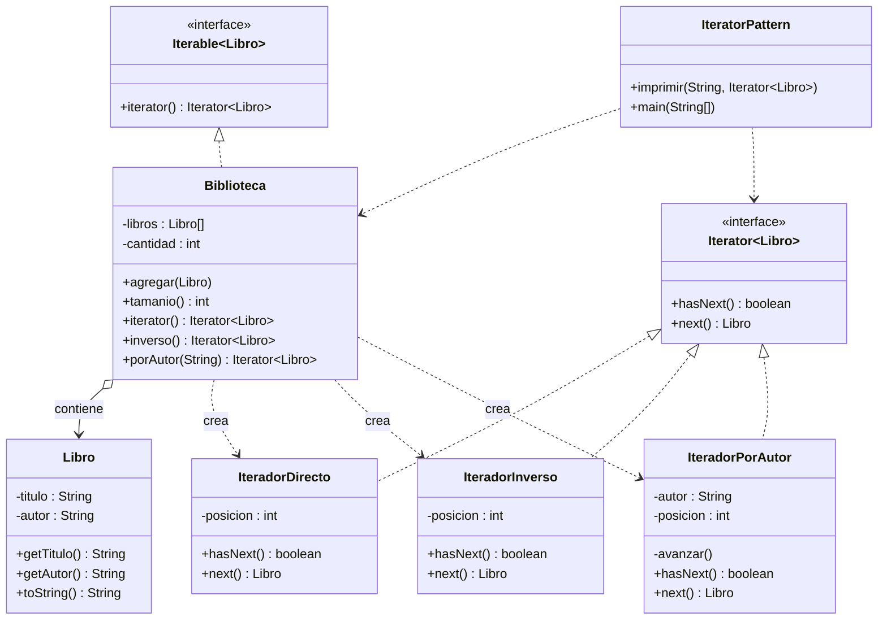

# Patrón Iterator

**Categoría:** Comportamiento

## Descripción
Permite recorrer los elementos de una colección de forma secuencial sin exponer su representación interna. El recorrido se delega a un objeto aparte, el **iterador**, que ofrece una interfaz uniforme (`hasNext()` y `next()`).

## Problema
Una colección puede guardar sus elementos de muchas maneras (arreglo, lista, árbol, etc.). Si el cliente recorre directamente la estructura interna, queda acoplado a ella: cualquier cambio en la colección rompe el código que la usa. Además, cada nueva forma de recorrer (al revés, filtrando, saltando elementos) obligaría a agregar métodos o lógica dentro de la colección, y la clase se va inflando.

En este ejemplo, `Biblioteca` guarda sus libros en un arreglo (`Libro[]`). Sin el patrón, el cliente tendría que conocer el arreglo y el contador `cantidad` para recorrerlo, y haría falta escribir a mano cada recorrido (directo, inverso, por autor).

## Solución
Se extrae el recorrido a clases separadas que implementan `java.util.Iterator<Libro>`. `Biblioteca` implementa `Iterable<Libro>` y solo se ocupa de crear el iterador adecuado. El cliente recorre cualquier iterador con la misma interfaz, sin saber cómo está guardada la colección.

Los iteradores son clases internas (`private class`) de `Biblioteca`, por lo que acceden al arreglo y a `cantidad` sin exponerlos al exterior. Cada iterador guarda su propia posición, así que se pueden usar varios al mismo tiempo sobre la misma biblioteca.

## UML

## Participantes
| Rol del patrón | Clase en el código |
|---|---|
| Iterator | `java.util.Iterator<Libro>` |
| ConcreteIterator | `IteradorDirecto`, `IteradorInverso`, `IteradorPorAutor` |
| Aggregate (Iterable) | `java.util.Iterable<Libro>` |
| ConcreteAggregate | `Biblioteca` |
| Elemento | `Libro` |
| Client | `IteratorPattern.main` y `imprimir` |

## Recorridos implementados
- **Directo** (`iterator()`): del primer al último libro. Es el que habilita el `for-each`.
- **Inverso** (`inverso()`): del último al primero.
- **Por autor** (`porAutor(String)`): solo los libros de un autor; salta los que no coinciden.

Si se llama a `next()` sin elementos restantes, se lanza `NoSuchElementException`, como pide el contrato de `Iterator`.

## Ventajas
- **Responsabilidad única:** la colección guarda datos y los iteradores se encargan del recorrido.
- **Encapsulamiento:** el cliente no conoce el arreglo interno de `Biblioteca`.
- **Abierto/cerrado:** se puede agregar un nuevo recorrido (por ejemplo, por título) con una clase nueva, sin modificar el cliente.
- **Recorridos simultáneos:** cada iterador tiene su propia posición.
- **Interfaz uniforme:** al implementar `Iterable`, la colección funciona con `for-each` y con cualquier código que trabaje con `Iterator`.

## Desventajas
- Es excesivo si la colección es simple y solo se recorre de una forma.
- Agrega clases al diseño (una por cada tipo de recorrido).
- Recorrer con un iterador puede ser menos eficiente que acceder directamente al arreglo por índice.
- Si la colección se modifica durante el recorrido, el comportamiento no está definido (este ejemplo no implementa detección de modificaciones concurrentes).

