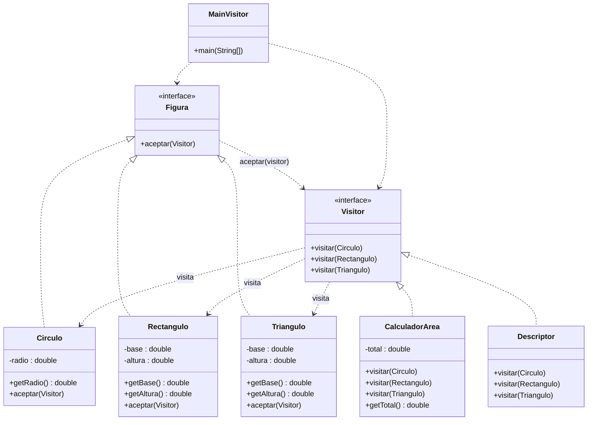

# Patrón Visitor

**Categoría:** Comportamiento

## Descripción
Permite agregar nuevas operaciones a una jerarquía de objetos sin modificar sus clases. La operación se mueve a un objeto aparte, el **visitor**, y cada elemento solo sabe "aceptar" visitantes.

## Problema
Tenemos una jerarquía de figuras (`Circulo`, `Rectangulo`, `Triangulo`) y necesitamos operaciones sobre ellas: calcular el área total, describirlas, y probablemente más adelante calcular perímetros, exportarlas, dibujarlas, etc.

Si cada operación se agrega como un método dentro de las figuras:

- Las clases se llenan de responsabilidades que no les corresponden.
- Hay que modificar las tres clases cada vez que aparece una operación nueva.
- La lógica de una misma operación queda repartida en varias clases.

## Solución
Se crea la interfaz `Visitor` con un método `visitar` por cada tipo concreto de figura. Cada figura implementa `aceptar(Visitor)` y se devuelve a sí misma al visitor: `visitor.visitar(this)`.

Esto es el **doble despacho (double dispatch)**: el método que se ejecuta depende de dos tipos a la vez, el del visitor (`CalculadorArea` o `Descriptor`) y el de la figura (`Circulo`, `Rectangulo` o `Triangulo`). Así no hace falta `instanceof` ni `if` para distinguir figuras.

Cada operación nueva es una clase `Visitor` nueva. Las figuras no se tocan.

## UML

## Participantes
- **Visitor:** interfaz con un método `visitar` por cada tipo concreto de figura.
- **CalculadorArea:** visitor concreto que acumula el área total de todas las figuras (guarda estado en `total`).
- **Descriptor:** visitor concreto que imprime una descripción de cada figura.
- **Figura:** interfaz del elemento, declara `aceptar(Visitor)`.
- **Circulo, Rectangulo, Triangulo:** elementos concretos; cada uno llama al `visitar` que le corresponde.
- **MainVisitor:** cliente que recorre la lista de figuras y les pasa los visitors.

## Flujo de ejecución
1. El cliente recorre la lista de figuras.
2. Por cada figura llama a `figura.aceptar(visitor)`.
3. La figura ejecuta `visitor.visitar(this)`, y Java elige la sobrecarga correcta según su tipo.
4. El visitor aplica su operación, usando los getters de la figura.

## Ventajas
- **Abierto/cerrado:** se agregan operaciones nuevas (perímetro, exportar a JSON, etc.) creando un visitor, sin modificar las figuras.
- **Responsabilidad única:** cada operación vive completa en una sola clase, en vez de repartirse entre las figuras.
- **Estado acumulado:** `CalculadorArea` va sumando mientras recorre la estructura.
- **Sin `instanceof`:** el doble despacho resuelve el tipo de cada figura.

## Desventajas
- **Agregar una figura nueva es costoso:** hay que agregar un método a la interfaz `Visitor` y a todos los visitors existentes (`CalculadorArea`, `Descriptor`, ...).
- **Encapsulamiento debilitado:** las figuras deben exponer sus datos con getters para que los visitors puedan trabajar.
- **Más clases e indirección** que un simple método polimórfico, lo que no se justifica si hay pocas operaciones o si la jerarquía cambia seguido.
- Cada elemento debe implementar `aceptar` aunque su código sea siempre igual.

## Cuándo usarlo
Conviene cuando la jerarquía de elementos es **estable** pero las operaciones sobre ella **cambian o crecen**. Si pasa lo contrario (muchas figuras nuevas y pocas operaciones), el polimorfismo clásico es mejor.

