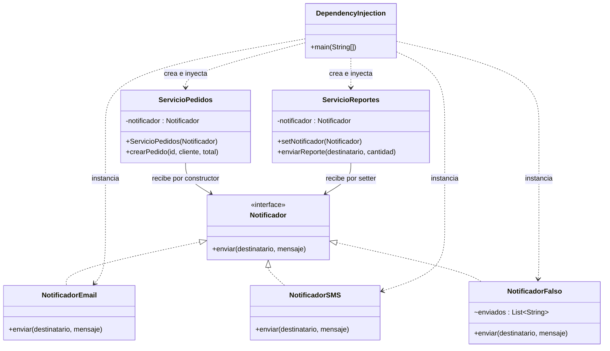

# Dependency Injection (Inyección de Dependencias)

**Categoría:** Técnica de Inversión de Control (IoC). No pertenece a los 23 patrones del GoF, pero es un patrón de diseño muy usado.

## Descripción
Una clase no crea las dependencias que necesita: las **recibe desde afuera**. Así depende de una abstracción (interfaz) y no de una implementación concreta, y quien arma el programa decide qué implementación entregarle.

## Problema
Si `ServicioPedidos` creara su propio notificador con `new NotificadorEmail()`, quedaría atada a esa clase concreta:

- Para pasar de email a SMS habría que modificar `ServicioPedidos`.
- No se podría probar sin enviar emails de verdad.
- No se podría reutilizar con otro tipo de notificación.

## Solución
Se define la interfaz `Notificador` y las clases que la necesitan la reciben ya construida:

- `ServicioPedidos` la recibe por **constructor** (inyección obligatoria y objeto siempre válido).
- `ServicioReportes` la recibe por **setter** (inyección opcional y cambiable en tiempo de ejecución).

El `main` actúa como **composition root**: es el único lugar que conoce las clases concretas y las conecta.

## UML

## Participantes
- **Notificador:** abstracción de la que dependen los servicios.
- **NotificadorEmail, NotificadorSMS:** implementaciones reales e intercambiables.
- **NotificadorFalso:** implementación de prueba (mock) que guarda los mensajes en una lista en vez de enviarlos.
- **ServicioPedidos:** cliente con inyección por constructor.
- **ServicioReportes:** cliente con inyección por setter.
- **DependencyInjection.main:** composition root que crea y conecta los objetos.

## Tipos de inyección en el ejemplo
- **Por constructor** (`ServicioPedidos`): la dependencia es obligatoria y `final`. Es la opción más recomendada.
- **Por setter** (`ServicioReportes`): permite cambiar la dependencia después de crear el objeto, pero el objeto puede quedar sin notificador si nadie llama al setter.

## Ventajas
- **Bajo acoplamiento:** los servicios dependen de `Notificador`, no de clases concretas.
- **Fácil de probar:** `NotificadorFalso` permite verificar el comportamiento sin enviar nada (el test del `main` lo hace).
- **Intercambiable:** pasar de email a SMS se resuelve en el `main`, sin tocar los servicios.
- **Reutilización:** el mismo notificador sirve para pedidos y reportes.
- **Cumple el principio de inversión de dependencias (D de SOLID)** y el abierto/cerrado.

## Desventajas
- Agrega interfaces y clases al diseño.
- El armado de objetos se concentra en un lugar y puede crecer mucho en programas grandes (por eso existen frameworks como Spring).
- Con inyección por setter hay riesgo de usar el objeto sin haber inyectado la dependencia (`NullPointerException`).
- El flujo de creación es menos evidente al leer cada clase por separado.

