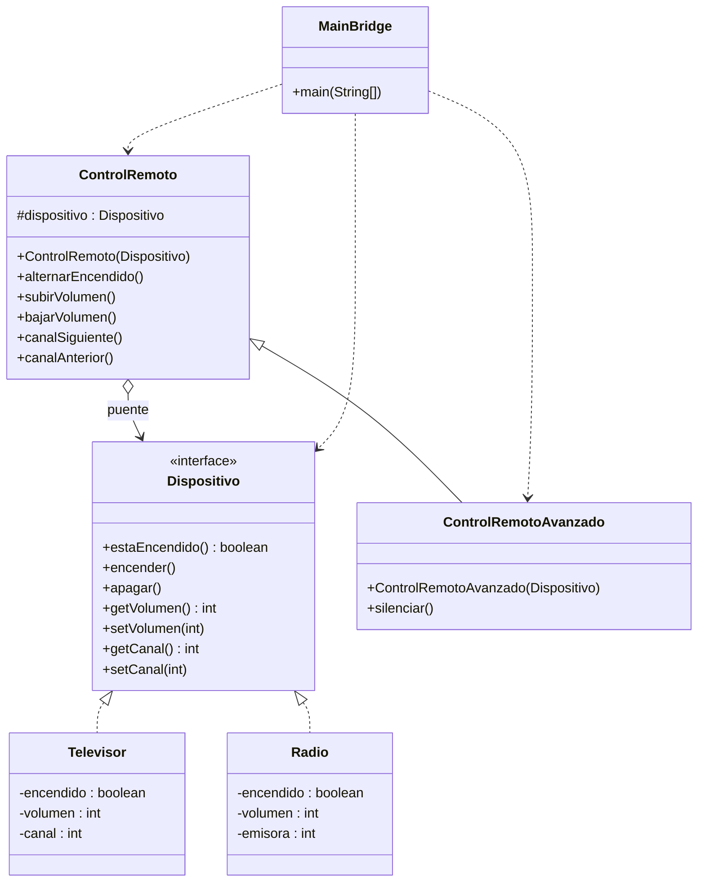

# Patrón Bridge

**Categoría:** Estructural

## Descripción
Separa una abstracción de su implementación para que ambas puedan variar de forma independiente. En lugar de usar herencia para combinar las dos dimensiones, la abstracción **contiene una referencia** a la implementación y le delega el trabajo (el "puente" es esa composición).

## Problema
Tenemos dos dimensiones que varían por separado:

- **Qué control se usa:** básico (`ControlRemoto`) o avanzado (`ControlRemotoAvanzado`, que agrega `silenciar()`).
- **Qué dispositivo se controla:** `Televisor` o `Radio`.

Resolverlo solo con herencia obliga a crear una clase por cada combinación: `ControlBasicoTelevisor`, `ControlBasicoRadio`, `ControlAvanzadoTelevisor`, `ControlAvanzadoRadio`. Con 2 controles y 2 dispositivos son 4 clases; con 3 y 3 serían 9. Cada tipo nuevo multiplica la cantidad de clases y el código se duplica.

## Solución
Se arman dos jerarquías separadas, unidas por composición:

- **Abstracción:** `ControlRemoto` y su variante `ControlRemotoAvanzado`. Guardan un `Dispositivo` (atributo `dispositivo`, el puente) y le delegan las operaciones reales.
- **Implementación:** la interfaz `Dispositivo` con sus clases `Televisor` y `Radio`.

Ahora cualquier control funciona con cualquier dispositivo, y agregar un control o un dispositivo nuevo es una sola clase, sin tocar las demás.

## UML

## Participantes
| Rol del patrón | Clase en el código |
|---|---|
| Implementor | `Dispositivo` |
| ConcreteImplementor | `Televisor`, `Radio` |
| Abstraction | `ControlRemoto` |
| RefinedAbstraction | `ControlRemotoAvanzado` |
| Client | `MainBridge` |

## Cómo funciona el puente
`ControlRemoto` no sabe si controla un televisor o una radio: solo conoce la interfaz `Dispositivo`. Por ejemplo, `subirVolumen()` hace `dispositivo.setVolumen(dispositivo.getVolumen() + 10)` y cada dispositivo aplica su propia lógica (incluido el límite de 0 a 100). `ControlRemotoAvanzado` hereda todo eso y suma `silenciar()` sin modificar ningún dispositivo.

## Ventajas
- **Evita la explosión de subclases:** 2 + 2 clases en lugar de 2 x 2 combinaciones.
- **Abierto/cerrado:** se puede agregar un `Aire Acondicionado` o un `ControlPorVoz` sin modificar las clases existentes.
- **Desacoplamiento:** el control no depende de ningún dispositivo concreto, solo de la interfaz.
- **Flexibilidad en ejecución:** el mismo control puede cambiar de dispositivo, y el cliente elige la combinación al crear el objeto.
- **Responsabilidad única:** el control se ocupa de la interacción y el dispositivo de su funcionamiento.

## Desventajas
- **Más complejidad** si solo hay una dimensión de variación: en ese caso una interfaz y herencia simple alcanzan.
- **Requiere identificar bien las dos dimensiones** desde el diseño; si se separan mal, la interfaz `Dispositivo` queda forzada (acá, por ejemplo, `Radio` usa "canal" para representar la emisora).
- **Una interfaz grande acopla las implementaciones:** agregar un método a `Dispositivo` obliga a implementarlo en `Televisor` y `Radio`.
- **Agrega un nivel de indirección** al leer y depurar el código.

## Bridge vs. otros patrones
- **Adapter** se aplica a código ya existente para hacerlo compatible. **Bridge** se diseña desde el inicio para que dos jerarquías evolucionen por separado.
- **Strategy** también usa composición, pero cambia un algoritmo. **Bridge** separa una jerarquía completa de abstracciones de otra de implementaciones.

